<div align="center">

# Minute

### Meeting notes that never leave your Mac.

Minute records a meeting, transcribes it while you talk, and writes the summary.
All of it runs on your Mac.

**[Download for Apple silicon](https://github.com/mraza007/minute/releases/download/v1.13.0/Minute-1.13.0-arm64.zip)**
&nbsp;·&nbsp;
[Download for Intel](https://github.com/mraza007/minute/releases/download/v1.13.0/Minute-1.13.0-x86_64.zip)
&nbsp;·&nbsp;
[All releases](https://github.com/mraza007/minute/releases/latest)

<a href="screenshots/demo.mp4"></a>

[Watch the full demo with sound](screenshots/demo.mp4)

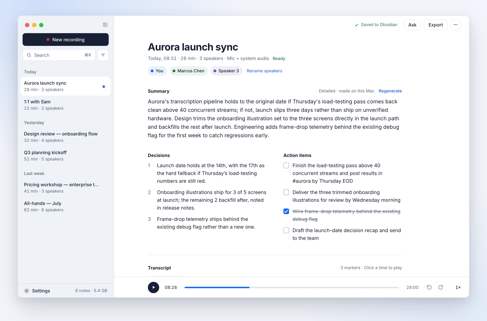

</div>

## Why Minute

Most meeting recorders send your audio to a server. Minute does not have one.
The speech model and the language model run inside the app, and each note is a
folder of plain files on your disk.

Turn off Wi-Fi and record a meeting. Minute transcribes it, summarizes it, and
answers questions about it the same way it does online.

Minute is free and open source under the MIT license. It has no account and no
analytics, and you choose the models.

## What it does

### Detects your meetings

Turn on **Detect meetings**. When a call starts in Zoom, Teams, Slack, FaceTime,
Webex, Discord, or a browser, a small pill offers to record it. Minute stops
when the call ends.

<p align="center">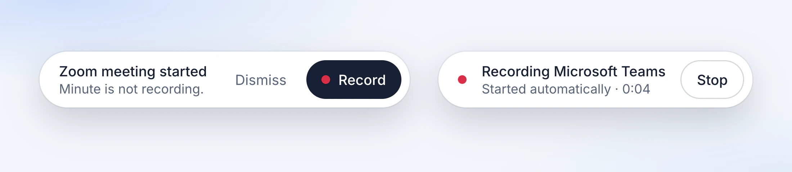</p>

Detection is off by default, and it does not open the microphone.

<details>
<summary>Detection rules and automatic stop</summary>

<br>

Turn on **Detect meetings** in **Settings → Recording**. When a meeting app
starts to use the microphone, the pill appears above your work. Click
**Record**, or click **Dismiss**. The pill closes after 12 seconds if you do nothing.

Each app has its own rule: **Ask me**, **Record automatically**, or **Do nothing**.
The list covers Zoom, Microsoft Teams, Webex, Slack, FaceTime, Discord, and calls
in Safari, Chrome, Arc, Edge, or Firefox. A Google Meet call counts as a browser call.

<p align="center">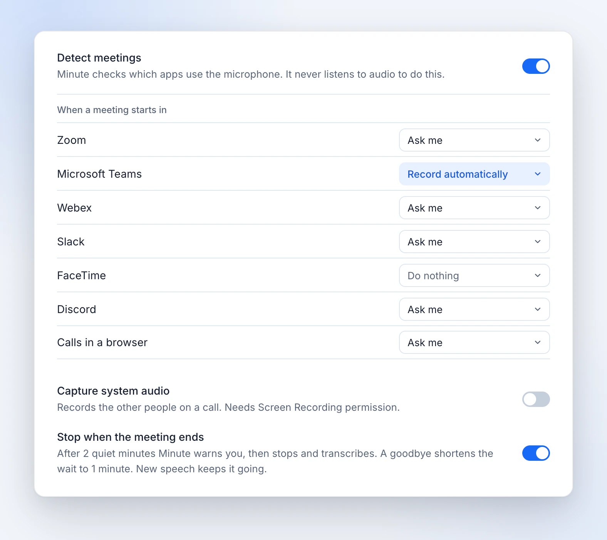</p>

To detect a meeting, Minute checks which apps are running and whether they use
the microphone. It does not open the microphone and it does not listen.

Minute stops a recording as follows:

- After 2 quiet minutes, Minute shows a 2-minute countdown, then stops and transcribes.
- A closing phrase such as "thanks everyone" shortens the wait to 1 minute.
- When the meeting app quits, the countdown starts after a few seconds.
- New speech or **Keep recording** cancels the countdown.

</details>

### Transcribes while you talk

The transcript appears as people speak. Turn on **Capture system audio** to
record the other people on the call.

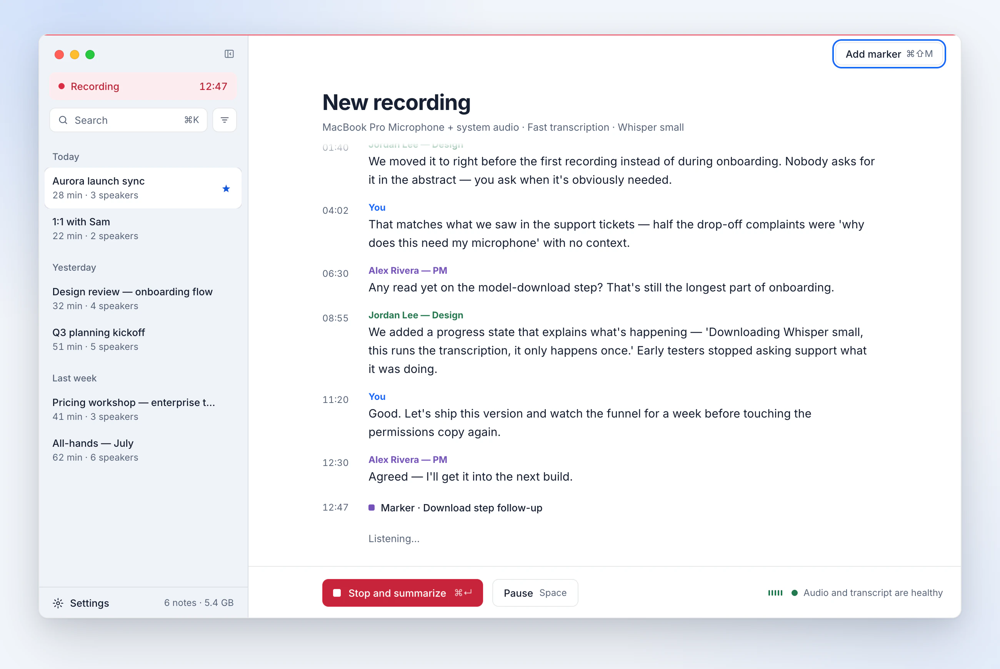

<details>
<summary>Recording details</summary>

<br>

- Before you record, Minute shows the microphone, a live input level, and the transcription model.
- **Capture system audio** needs macOS 13 or later and the Screen Recording permission. Without it, Minute records your microphone only.
- Minute warns you about long silence, clipping, a disconnected microphone, or slow transcription.
- Press `Space` to pause, `⌘⇧M` to add a marker, and `⌘↵` to stop.

</details>

### Writes the summary, decisions, and action items

When the recording stops, the language model reads the transcript and writes a
summary, the decisions, and the action items. They sit above the transcript on
one page, and you can check off action items there.

<details>
<summary>Summary options</summary>

<br>

- Choose **Short**, **Standard**, or **Detailed** in **Settings → Summaries**.
- Add your own instructions, such as "write it in German".
- Click **Regenerate** to write the summary again with the current settings.
- If the meeting is too long for the model, the summary says that it covers only part of the recording.

</details>

### Answers questions about the meeting

Click **Ask** and type a question. Minute answers from this meeting's transcript
only. Click a time in the answer to play that moment.

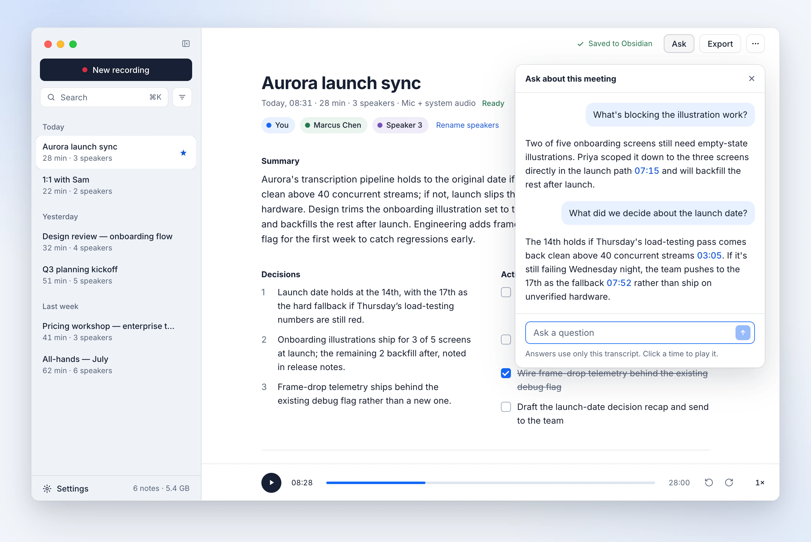

### Knows who spoke

Turn on **Detect speakers** and Minute labels each turn by voice. Click a speaker
to rename it, and the new name replaces the old one everywhere in the note.

<p align="center">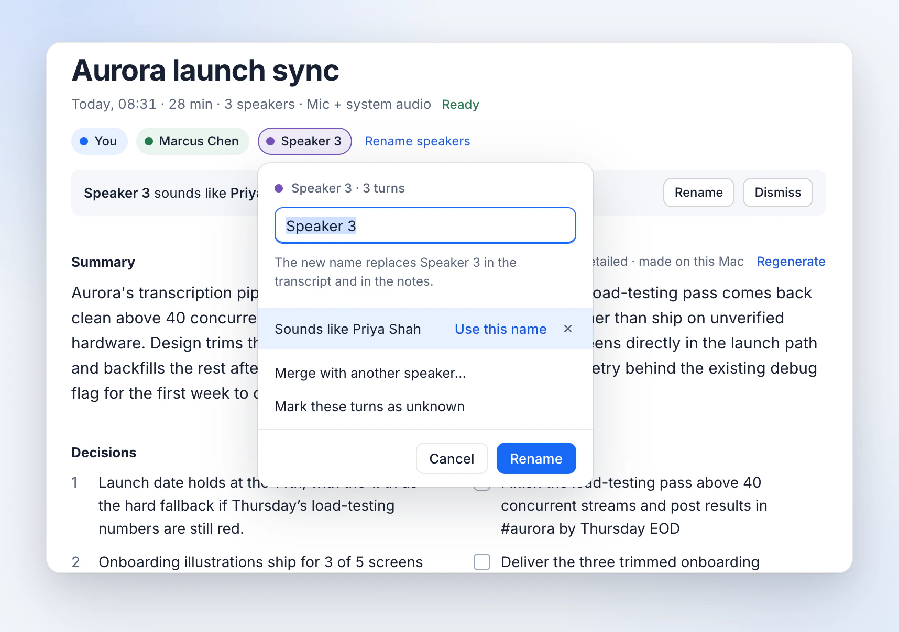</p>

<details>
<summary>Speaker detection, voice profiles, and unknown speakers</summary>

<br>

Turn on **Detect speakers** in **Settings → Speakers**. Two small models
(34 MB together) label the turns on your Mac. A new name replaces the old one in
the transcript, the summary, the decisions, and the action items.

Turn on **Remember named speakers** and Minute saves a voice profile when you
name someone. In later meetings, a clear match gets the name automatically, and
a weaker match becomes a suggestion that you confirm or dismiss. Voice profiles
stay in your library folder. You can delete each one in Settings.

Minute does not guess. A turn with no clear voice is labeled **Unknown speaker**.
You can also mark a speaker's turns as unknown, then assign them to the right
person later. Every one of these changes has **Undo**.

<p align="center">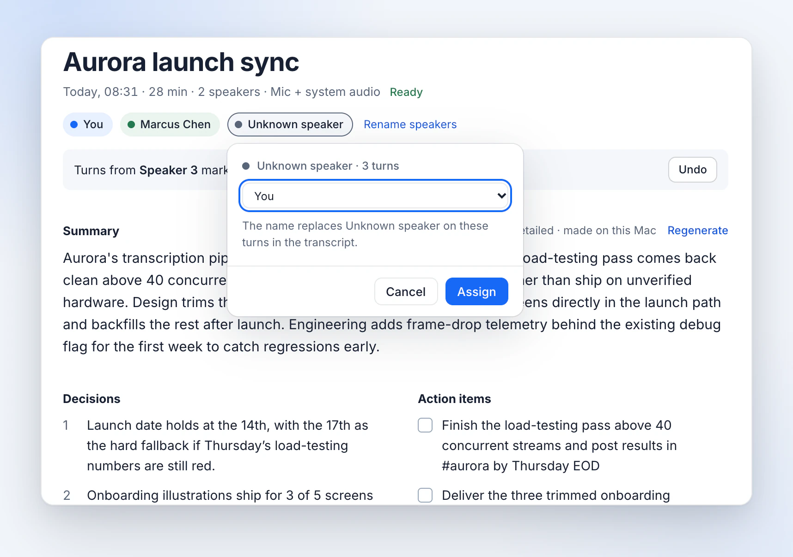</p>

</details>

### Finds anything you said

Press `⌘K` to search titles and the full text of every transcript. Open a
transcript result and Minute plays the recording from that sentence.

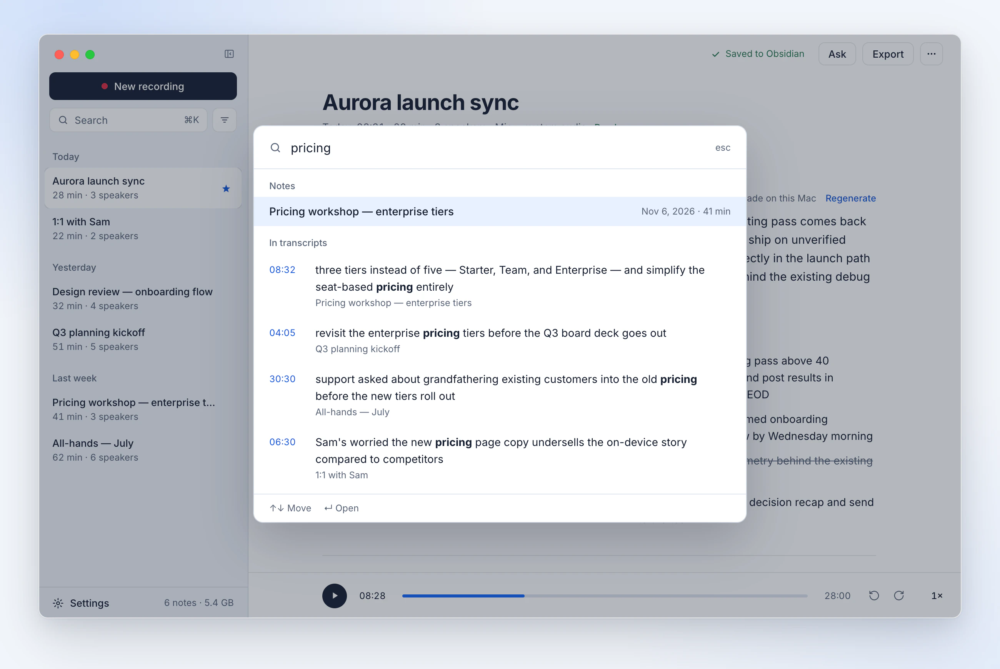

The filter menu beside the search field sorts the library and filters it by
status, source, or date.

### Saves to Obsidian and Markdown

Choose your Obsidian vault folder, and Minute writes one Markdown file each time
a summary finishes. Without Obsidian, export a note or copy it as Markdown.

<p align="center">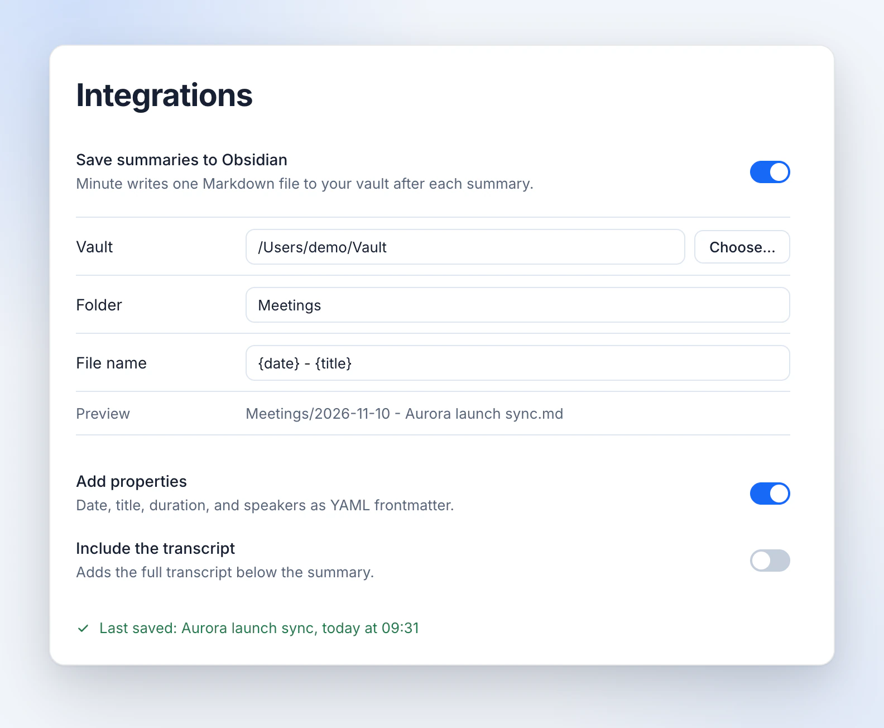</p>

<details>
<summary>Obsidian and export details</summary>

<br>

- Turn on Obsidian in **Settings → Integrations** and choose your vault folder.
- The file name template accepts `{date}` and `{title}`.
- **Add properties** writes `date`, `title`, `duration`, and `speakers` as YAML frontmatter.
- Minute does not overwrite your edits. If you change the file in Obsidian, the note shows "Not saved to Obsidian" until you choose **Save to Obsidian again**.
- Without Obsidian, use **Export** to save a note as Markdown, or **Copy as Markdown** in the note's **…** menu.

</details>

### Follows light and dark mode

Minute follows the macOS appearance setting.

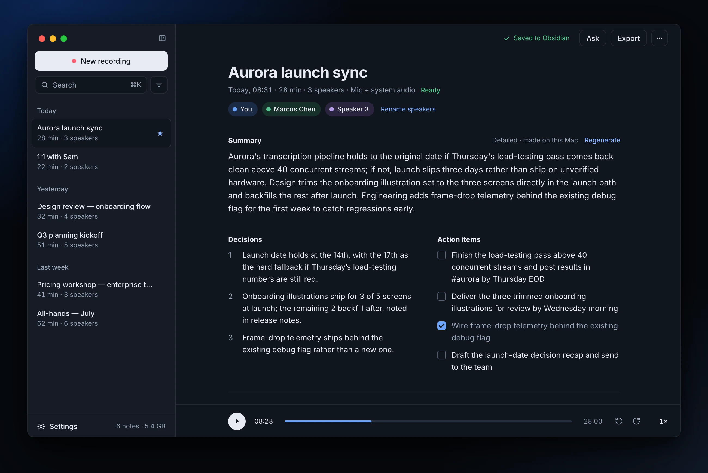

## Models

Minute uses Whisper for transcription, a language model for summaries and Ask,
and two small models for speaker detection. You download each model once. After
that, it runs offline.

<p align="center">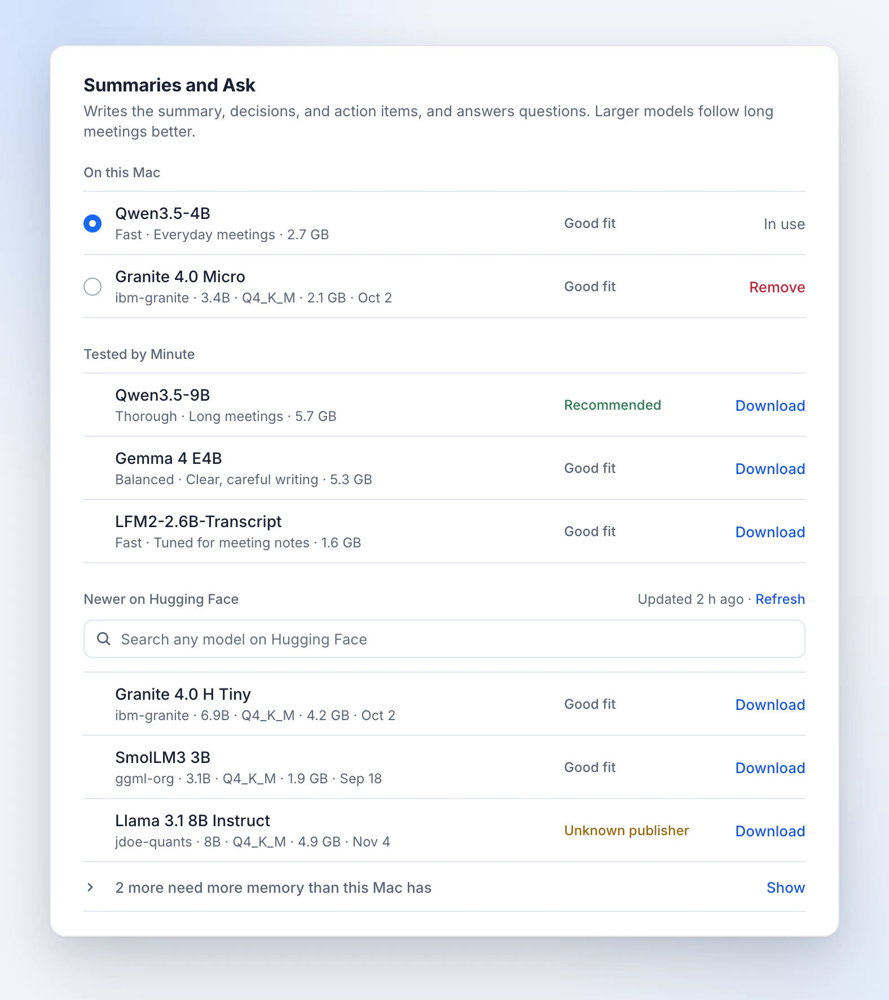</p>

Minute reads the chip, memory, and CPU cores of your Mac and tells you which
models fit. You can remove a model at any time in **Settings → Models**.

<details>
<summary>Tested models</summary>

<br>

These models are in [`src-tauri/catalog.json`](src-tauri/catalog.json). Each one
has a pinned SHA-256 hash.

| Transcription | Size | Memory | Notes |
| --- | --- | --- | --- |
| Whisper small | 488 MB | Any | Fast, 99 languages |
| Whisper small, English | 488 MB | Any | Fast, English only |
| Whisper medium, compact | 539 MB | 8 GB | Balanced, 99 languages |
| Whisper medium | 1.5 GB | 16 GB | Balanced, 99 languages |
| Whisper large-v3-turbo, compact | 574 MB | 8 GB | Most accurate, Apple silicon only |
| Whisper large-v3-turbo | 1.6 GB | 16 GB | Most accurate, Apple silicon only |
| Whisper large-v3, compact | 1.1 GB | 16 GB | Most accurate, slower, Apple silicon only |

| Summaries and Ask | Size | Memory | Notes |
| --- | --- | --- | --- |
| LFM2-2.6B-Transcript | 1.6 GB | 8 GB | Smallest, tuned for meeting notes |
| Ministral 3 3B | 2.1 GB | 8 GB | Fast, gets owners right |
| Qwen3.5-4B | 2.7 GB | 8 GB | Fast, good default |
| Gemma 4 E4B | 5.3 GB | 16 GB | Balanced, clear and careful writing |
| Granite 4.2 8B | 5.3 GB | 16 GB | Balanced, most complete notes |
| Qwen3.5-9B | 5.7 GB | 16 GB | Most capable, slower |
| Gemma 4 12B | 7.0 GB | 16 GB | Thorough, best in our tests |

Minute labels each model **Recommended**, **Good fit**, **Near memory limit**,
**Below minimum**, or **Not supported**.

</details>

<details>
<summary>Newer models from Hugging Face</summary>

<br>

The Models page also lists models that are newer than the tested list.

- **Newer on Hugging Face** shows trending GGUF models from trusted publishers only. The trusted publishers are `ggml-org`, `ggerganov`, `unsloth`, `bartowski`, `lmstudio-community`, `Qwen`, `google`, `LiquidAI`, `ibm-granite`, `mistralai`, `microsoft`, `HuggingFaceTB`, `meta-llama`, `nvidia`, and `allenai`.
- Minute lists a model only if the app can run it. The model must be public, must have a chat template, and must use an architecture that passed the app's summary tests: Qwen 3.5, Gemma 4, LFM2, Granite, or Mistral 3.
- **Search** finds models from any publisher. A model from another publisher is labeled **Unknown publisher**, and Minute asks you to confirm before it downloads.
- Minute checks every download against the SHA-256 hash that Hugging Face lists for the file.
- Minute keeps the list for 24 hours. If you are offline, the page shows the last list.

</details>

## Privacy

Recording, transcription, speaker detection, summaries, Ask, and search do not
use the network.

Minute connects to the internet in three cases only: to download a model, to
list models, and to check for an update. None of these requests contains audio,
transcripts, summaries, or note titles.

<details>
<summary>Every network request</summary>

<br>

| When | Where | What Minute sends |
| --- | --- | --- |
| You download a model | `huggingface.co` | A request for the model file |
| You open **Settings → Models**, click **Refresh**, or search there | `huggingface.co` | A request for the model list, plus your search text if you search |
| Minute checks for an update, at launch and every 6 hours | `github.com` | A request for the release file `latest.json` |

To stop the update check, turn it off in **Settings → About**.

More facts you can check in the code:

- The app's [content security policy](src-tauri/tauri.conf.json) allows no remote origin. The interface cannot load a script, font, or image from the internet.
- Whisper, llama.cpp, and sherpa-onnx run inside the app process. Minute starts no local server and opens no port.
- The Inter font ships inside the app.
- Minute has no account and no analytics.

</details>

<details>
<summary>Note files and audio retention</summary>

<br>

Your notes are plain files:

```
~/Library/Application Support/dev.minute.app/notes/<note-id>/
├── audio.wav         the recording
├── transcript.json   timestamped segments with speaker labels
├── summary.json      summary, decisions, action items
├── meta.json         title, times, status, markers, speaker names
├── speakers.json     voice data for this note, if speakers were detected
└── note.md           the whole note as Markdown
```

By default, Minute deletes a note's audio 30 days after transcription and keeps
the transcript and the summary. You can turn this off in **Settings → Storage**.
The same page can convert older audio from WAV to AAC to save space.

</details>

## Install


1. Download the ZIP for your Mac: [Apple silicon](https://github.com/mraza007/minute/releases/download/v1.13.0/Minute-1.13.0-arm64.zip) or [Intel](https://github.com/mraza007/minute/releases/download/v1.13.0/Minute-1.13.0-x86_64.zip).
2. Unzip the file and move `Minute.app` to the Applications folder.
3. Open Minute and download the recommended models.
4. Start a recording. macOS asks for microphone access the first time.

Minute needs macOS 11 or later. Apple silicon is the tested target.

<details>
<summary>Requirements</summary>

<br>

- macOS 11 or later.
- macOS 13 or later to capture system audio.
- macOS 14.2 or later for Minute to detect that a call ended while the meeting app stays open.
- Apple silicon is the tested target. The Intel build is not yet tested on physical Intel hardware, and the large Whisper models need Apple silicon.
- 8 GB of memory for the smaller models. 16 GB for the larger models.
- About 3.2 GB of free disk space for Whisper small and Qwen3.5-4B, plus space for recordings.

</details>

<details>
<summary>Updates</summary>

<br>

Minute checks for new versions and shows an update button in **Settings → About**.
An update installs only when you click the button. Each update is signed, and
the app verifies the signature before it installs.

</details>

<details>
<summary>Keyboard shortcuts</summary>

<br>

| Action | Keys |
| --- | --- |
| Search notes and transcripts | `⌘K` or `⌘F` |
| Show the shortcut list | `⌘/` |
| Pause or resume a recording | `Space` |
| Add a marker while recording | `⌘⇧M` |
| Stop and transcribe | `⌘↵` |
| Go to the previous or next transcript turn | `↑` `↓` |
| Close a sheet | `Esc` |

</details>

## Contributing

Issues and pull requests are welcome. For a large change, open an
[issue](https://github.com/mraza007/minute/issues) first.

<details>
<summary>Build from source</summary>

<br>

Minute is a [Tauri 2](https://tauri.app) app with a React and TypeScript
interface and a Rust backend. You need Node 22, Rust 1.77.2 or later, and the
Xcode command line tools.

```bash
git clone https://github.com/mraza007/minute.git
cd minute
npm ci
npm run tauri:dev:sandbox
```

Use `npm run tauri:dev:sandbox` for development. It runs the app under a
separate identifier, so the app gets an empty library and its own settings.
`npm run tauri dev` opens your real library, and a bug in your change can
damage real recordings.

| Command | What it does |
| --- | --- |
| `npm run tauri:dev:sandbox` | Runs the app with hot reload and a separate, empty library |
| `npm run tauri build` | Builds the app for release |
| `npm test` | Runs the frontend tests |
| `npm run test:rust` | Runs the Rust tests |
| `npm run lint` | Runs oxlint |
| `npm run test:visual` | Runs the screenshot regression tests |
| `npm run verify` | Runs lint, tests, the build, and the release checks |

</details>

<details>
<summary>Pull request checklist</summary>

<br>

1. Develop against the sandbox library.
2. Run `npm run verify` before you open the pull request.
3. If you change the interface, run `npm run test:visual` and include the updated baselines.

</details>

## License

[MIT](LICENSE). The bundled `llama-cpp-2` sources in `src-tauri/vendor/` keep
their upstream MIT and Apache-2.0 licenses. Each model you download has its own
license.

<p align="center"><a href="https://www.producthunt.com/products/minute-4?embed=true&amp;utm_source=badge-featured&amp;utm_medium=badge&amp;utm_campaign=badge-minute-4" target="_blank" rel="noopener noreferrer"></a></p>
